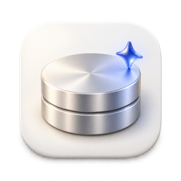

<div align="center">



# Lumen

**Inteligencia de almacenamiento para todos tus dispositivos.**

Lumen encuentra qué está ocupando espacio en tu disco y explica qué es cada elemento.
Solo mueve a una cuarentena reversible aquello que es seguro limpiar.

[](https://github.com/zaewc/Lumen/releases/latest)
[](https://github.com/zaewc/Lumen/actions/workflows/rust.yml)
[](LICENSE)

[**Descargar**](https://zaewc.github.io/Lumen/es/) · [Cómo funciona](ARCHITECTURE.md) · [Hoja de ruta](docs/architecture/roadmap.md)

<!-- language-tabs:start -->
<p>
<a href="README.ko.md" lang="ko" hreflang="ko"><picture><source media="(prefers-color-scheme: dark)" srcset="docs/assets/readme/language-tabs/ko-dark.svg"></picture></a><a href="README.md" lang="en" hreflang="en"><picture><source media="(prefers-color-scheme: dark)" srcset="docs/assets/readme/language-tabs/en-dark.svg"></picture></a><a href="README.ru.md" lang="ru" hreflang="ru"><picture><source media="(prefers-color-scheme: dark)" srcset="docs/assets/readme/language-tabs/ru-dark.svg"></picture></a><a href="README.ja.md" lang="ja" hreflang="ja"><picture><source media="(prefers-color-scheme: dark)" srcset="docs/assets/readme/language-tabs/ja-dark.svg"></picture></a><a href="README.zh-CN.md" lang="zh-CN" hreflang="zh-CN"><picture><source media="(prefers-color-scheme: dark)" srcset="docs/assets/readme/language-tabs/zh-CN-dark.svg"></picture></a><a href="README.es.md" lang="es" hreflang="es"><picture><source media="(prefers-color-scheme: dark)" srcset="docs/assets/readme/language-tabs/es-selected-dark.svg"></picture></a><a href="README.fr.md" lang="fr" hreflang="fr"><picture><source media="(prefers-color-scheme: dark)" srcset="docs/assets/readme/language-tabs/fr-dark.svg"></picture></a>
</p>
<!-- language-tabs:end -->


<picture>
  <source media="(prefers-color-scheme: dark)" srcset="docs/assets/readme/clean-up-dark.png">
  
</picture>

</div>

## Qué hace

- **Encuentra qué ocupa espacio**, desde DerivedData de Xcode y las cachés de Gradle
  hasta cachés de aplicaciones e instaladores antiguos, sin abrir ningún archivo.
- **Explica cada decisión.** Cada elemento se conserva, se deja para que lo revises o
  se propone para limpiar, con pruebas sobre su origen, si puede regenerarse y si sigue
  en uso.
- **Nunca elimina nada por su cuenta.** La limpieza mueve los elementos a una
  cuarentena en el mismo disco; puedes restaurarlos y solo se eliminan definitivamente
  cuando tú lo indicas.
- **Sabe cuándo una herramienta debe limpiarlo.** Para el almacén de pnpm, los
  simuladores de Xcode y otros casos, muestra el comando de la herramienta en vez de
  tocar los archivos.
- **Ofrece una segunda opinión de IA.** La revisión con IA describe los elementos que
  requieren revisión y solo puede hacer que una decisión sea más prudente.
- **Se actualiza desde la aplicación** (desde la versión 0.5.0). Las nuevas versiones
  se verifican con la clave de firma de Lumen antes de instalarse.

## Un vistazo más de cerca

<table>
  <tr>
    <td width="50%">
      <picture>
        <source media="(prefers-color-scheme: dark)" srcset="docs/assets/readme/review-dark.png">
        
      </picture>
      <p align="center"><b>Pruebas</b>: origen de un elemento y motivos de la decisión</p>
    </td>
    <td width="50%">
      <picture>
        <source media="(prefers-color-scheme: dark)" srcset="docs/assets/readme/overview-dark.png">
        
      </picture>
      <p align="center"><b>Almacenamiento</b>: capacidad del disco y composición del último análisis</p>
    </td>
  </tr>
  <tr>
    <td colspan="2">
      <picture>
        <source media="(prefers-color-scheme: dark)" srcset="docs/assets/readme/quarantine-dark.png">
        
      </picture>
      <p align="center"><b>Cuarentena</b>: restaura elementos o elimina varios definitivamente a la vez</p>
    </td>
  </tr>
</table>

## Cómo decide Lumen

Una política de seguridad determinista, no un modelo, toma cada decisión:

| Decisión | Significado |
| --- | --- |
| **Conservar** | Archivos del sistema, documentos, datos de aplicaciones, elementos en uso o sincronizados desde la nube y todo lo que Lumen no pudo leer por completo. |
| **Revisar** | Lumen no está seguro; tú decides. |
| **Limpiar** | Elementos conocidos y regenerables, como cachés de compilación. Primero van a cuarentena. |

Si hay dudas, Lumen conserva el archivo o te pide que lo revises. Antes de moverlo,
vuelve a comprobar que no haya cambiado ni esté en uso. Opera mediante un identificador
de archivo, nunca mediante una ruta consultada anteriormente. Consulta el
[contrato de seguridad del análisis](docs/architecture/scanner.md) y los
[registros de decisiones](docs/decisions/README.md).

## Revisión con IA

**La primera vez que se inicia, Lumen pregunta una sola vez si quieres usar la revisión
con IA** y no envía nada hasta que la actives. Puedes cambiar la opción en cualquier
momento desde Ajustes
([ADR-0050](docs/decisions/0050-ask-about-ai-review-on-first-launch.md)). Si está
activada, Lumen envía al modelo Jeb de la AI Hub de la escuela los metadatos de los
elementos que propone limpiar y de hasta 20 elementos grandes que deja para revisión.
Incluyen rutas (con tu carpeta personal representada como `~`), nombres, tamaños,
antigüedad y las pruebas de la decisión. El operador del servicio puede conservar las
solicitudes. **Nunca se envía el contenido de los archivos.** La respuesta de la IA es
solo una prueba: puede hacer que una decisión sea más prudente, nunca menos, y no
elige qué mover o eliminar
([ADR-0020](docs/decisions/0020-jev-evidence-only-judge.md)). La precisión y su
evaluación se explican en [`docs/ai/`](docs/ai/architecture.md).

## Instalación

Descarga la última beta desde la
[página de descargas](https://zaewc.github.io/Lumen/es/) o desde
[GitHub Releases](https://github.com/zaewc/Lumen/releases/latest).

| Plataforma | Paquete | Estado |
| --- | --- | --- |
| macOS 13 o posterior (Apple silicon e Intel) | `.dmg` | Beta |
| Windows 10 22H2 o posterior, Windows 11 | instalador (`-setup.exe`) | Beta |
| Linux (x86_64) | `.AppImage`, `.deb` | Beta |
| Android, iOS | | En desarrollo |

La beta aún no está firmada con un certificado de código, por lo que la primera vez
debes dar un paso adicional: en macOS, **Ajustes del Sistema › Privacidad y seguridad
› Abrir igualmente**; en Windows, **Más información › Ejecutar de todas formas**.
Cada archivo incluye una suma de comprobación SHA-256 y una atestación de procedencia
de compilación:

```sh
shasum -a 256 -c SHA256SUMS --ignore-missing
gh attestation verify <file> --repo zaewc/Lumen
```

## Compilar desde el código fuente

Necesitas Rust (la versión indicada en `rust-toolchain.toml`), Node.js 24 con Corepack
y [`just`](https://github.com/casey/just).

```sh
corepack enable && pnpm install
pnpm --filter @lumen/desktop tauri dev   # aplicación de escritorio
just check                               # formato, lint, pruebas, cargo-deny, esquemas y comprobaciones web
cargo run -p lumen-cli -- scan ~/Library --db index.db   # análisis de solo lectura por línea de comandos
```

Antes de abrir una solicitud de cambios, consulta [`CONTRIBUTING.md`](CONTRIBUTING.md)
y [`AGENTS.md`](AGENTS.md).

## Documentación

| Tema | Dónde |
| --- | --- |
| Arquitectura | [`ARCHITECTURE.md`](ARCHITECTURE.md), [sistema](docs/architecture/system.md), [plataformas](docs/architecture/platforms.md) |
| Decisiones | [`docs/decisions/`](docs/decisions/README.md) |
| Hoja de ruta | [`docs/architecture/roadmap.md`](docs/architecture/roadmap.md) |
| Revisión con IA | [`docs/ai/`](docs/ai/architecture.md) |
| Privacidad | [`docs/operations/privacy.md`](docs/operations/privacy.md) |
| Seguridad | [`SECURITY.md`](SECURITY.md), [modelo de amenazas](docs/security/threat-model.md) |

## Principios

- **La seguridad antes que el espacio recuperado.** Si hay dudas, Lumen conserva el
  archivo o te pide que lo revises.
- **Pruebas, no suposiciones.** Cada recomendación se puede explicar.
- **La IA solo asesora.** La respuesta del modelo es una prueba; decide una política
  determinista.
- **Reversible por defecto.** Antes de eliminar, los elementos pasan por cuarentena,
  verificación y posibilidad de restauración.
- **Local primero.** Los análisis, las decisiones y la cuarentena permanecen en tu
  dispositivo; el contenido de los archivos nunca sale de él.

## Licencia

Lumen se distribuye bajo la [Apache License, versión 2.0](LICENSE).
