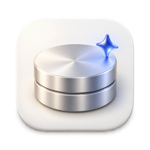

<div align="center">



# Lumen

**L'intelligence du stockage sur tous vos appareils.**

Lumen repère ce qui occupe votre disque et explique la nature de chaque élément.
Seuls les éléments qu'il est sûr de nettoyer sont placés en quarantaine, où vous
pouvez les restaurer.

[](https://github.com/zaewc/Lumen/releases/latest)
[](https://github.com/zaewc/Lumen/actions/workflows/rust.yml)
[](LICENSE)

[**Télécharger**](https://zaewc.github.io/Lumen/fr/) · [Fonctionnement](ARCHITECTURE.md) · [Feuille de route](docs/architecture/roadmap.md)

<!-- language-tabs:start -->
<p>
<a href="README.ko.md" lang="ko" hreflang="ko"><picture><source media="(prefers-color-scheme: dark)" srcset="docs/assets/readme/language-tabs/ko-dark.svg"></picture></a><a href="README.md" lang="en" hreflang="en"><picture><source media="(prefers-color-scheme: dark)" srcset="docs/assets/readme/language-tabs/en-dark.svg"></picture></a><a href="README.ru.md" lang="ru" hreflang="ru"><picture><source media="(prefers-color-scheme: dark)" srcset="docs/assets/readme/language-tabs/ru-dark.svg"></picture></a><a href="README.ja.md" lang="ja" hreflang="ja"><picture><source media="(prefers-color-scheme: dark)" srcset="docs/assets/readme/language-tabs/ja-dark.svg"></picture></a><a href="README.zh-CN.md" lang="zh-CN" hreflang="zh-CN"><picture><source media="(prefers-color-scheme: dark)" srcset="docs/assets/readme/language-tabs/zh-CN-dark.svg"></picture></a><a href="README.es.md" lang="es" hreflang="es"><picture><source media="(prefers-color-scheme: dark)" srcset="docs/assets/readme/language-tabs/es-dark.svg"></picture></a><a href="README.fr.md" lang="fr" hreflang="fr"><picture><source media="(prefers-color-scheme: dark)" srcset="docs/assets/readme/language-tabs/fr-selected-dark.svg"></picture></a>
</p>
<!-- language-tabs:end -->


<picture>
  <source media="(prefers-color-scheme: dark)" srcset="docs/assets/readme/clean-up-dark.png">
  
</picture>

</div>

## Ce que fait Lumen

- **Repère ce qui occupe de l'espace**, des données DerivedData de Xcode et des caches
  Gradle aux caches d'applications et aux anciens installateurs, sans ouvrir de fichier.
- **Explique chaque décision.** Chaque élément est conservé, laissé à votre examen ou
  proposé au nettoyage, avec les preuves disponibles : son origine, la possibilité de
  le recréer et son éventuelle utilisation.
- **Ne supprime jamais de lui-même.** Le nettoyage place les éléments en quarantaine
  sur le même disque. Vous pouvez les restaurer ; ils ne sont supprimés définitivement
  que lorsque vous le demandez.
- **Sait quand un outil doit faire le nettoyage.** Pour le magasin pnpm, les
  simulateurs Xcode et autres cas similaires, Lumen affiche la commande de l'outil au
  lieu de toucher aux fichiers.
- **Propose un second avis de l'IA.** L'analyse par IA décrit les éléments à examiner
  et ne peut rendre une décision que plus prudente.
- **Se met à jour depuis l'application** (depuis la version 0.5.0). Les nouvelles
  versions sont vérifiées avec la clé de signature de Lumen avant leur installation.

## Quelques captures

<table>
  <tr>
    <td width="50%">
      <picture>
        <source media="(prefers-color-scheme: dark)" srcset="docs/assets/readme/review-dark.png">
        
      </picture>
      <p align="center"><b>Preuves</b> : origine d'un élément et raisons de la décision</p>
    </td>
    <td width="50%">
      <picture>
        <source media="(prefers-color-scheme: dark)" srcset="docs/assets/readme/overview-dark.png">
        
      </picture>
      <p align="center"><b>Stockage</b> : capacité du disque et composition du dernier scan</p>
    </td>
  </tr>
  <tr>
    <td colspan="2">
      <picture>
        <source media="(prefers-color-scheme: dark)" srcset="docs/assets/readme/quarantine-dark.png">
        
      </picture>
      <p align="center"><b>Quarantaine</b> : restaurez des éléments ou supprimez-en plusieurs définitivement à la fois</p>
    </td>
  </tr>
</table>

## Comment Lumen prend ses décisions

Chaque décision est prise par une politique de sécurité déterministe, pas par un modèle :

| Décision | Signification |
| --- | --- |
| **Conserver** | Fichiers système, documents, données d'applications, éléments utilisés ou synchronisés depuis le cloud, et tout élément que Lumen n'a pas pu lire entièrement. |
| **À examiner** | Lumen n'est pas sûr ; c'est à vous de décider. |
| **Nettoyer** | Éléments connus et régénérables, comme les caches de compilation. Ils passent d'abord en quarantaine. |

En cas de doute, Lumen conserve le fichier ou vous demande de l'examiner. Avant tout
déplacement, il vérifie à nouveau que l'élément n'a pas changé et n'est pas utilisé.
Il agit au moyen d'un handle de fichier, jamais à partir d'un chemin résolu auparavant.
Les règles sont décrites dans le
[contrat de sécurité du scanner](docs/architecture/scanner.md) et les
[décisions d'architecture](docs/decisions/README.md).

## Analyse par IA

**Au premier lancement, Lumen vous demande une seule fois si vous souhaitez utiliser
l'analyse par IA** et n'envoie rien avant votre choix. Vous pouvez modifier ce réglage
à tout moment dans les paramètres
([ADR-0050](docs/decisions/0050-ask-about-ai-review-on-first-launch.md)). Lorsqu'elle
est activée, Lumen envoie au modèle Jeb de l'AI Hub de l'établissement les métadonnées
des éléments proposés au nettoyage et d'au plus 20 grands éléments laissés à examiner.
Elles comprennent les chemins (votre dossier personnel est indiqué par `~`), les noms,
les tailles, l'ancienneté et les éléments qui motivent la décision. L'opérateur du
service peut conserver les requêtes. **Le contenu des fichiers n'est jamais envoyé.**
La réponse de l'IA n'est qu'un élément de preuve : elle peut rendre une décision plus
prudente, jamais moins, et ne choisit jamais ce qu'il faut déplacer ou supprimer
([ADR-0020](docs/decisions/0020-jev-evidence-only-judge.md)). La précision et son
évaluation sont détaillées dans [`docs/ai/`](docs/ai/architecture.md).

## Installation

Téléchargez la dernière bêta depuis la
[page de téléchargement](https://zaewc.github.io/Lumen/fr/) ou les
[versions GitHub](https://github.com/zaewc/Lumen/releases/latest).

| Plateforme | Paquet | État |
| --- | --- | --- |
| macOS 13 ou ultérieur (Apple silicon et Intel) | `.dmg` | Bêta |
| Windows 10 22H2 ou ultérieur, Windows 11 | installateur (`-setup.exe`) | Bêta |
| Linux (x86_64) | `.AppImage`, `.deb` | Bêta |
| Android, iOS | | En développement |

La bêta n'est pas encore signée. Au premier lancement, une étape supplémentaire est
nécessaire : sur macOS, **Réglages Système › Confidentialité et sécurité › Ouvrir
quand même** ; sur Windows, **Informations complémentaires › Exécuter quand même**.
Chaque fichier est accompagné d'une somme de contrôle SHA-256 et d'une attestation de
provenance de compilation :

```sh
shasum -a 256 -c SHA256SUMS --ignore-missing
gh attestation verify <file> --repo zaewc/Lumen
```

## Compiler depuis les sources

Vous aurez besoin de Rust (la version indiquée dans `rust-toolchain.toml`), de Node.js
24 avec Corepack et de [`just`](https://github.com/casey/just).

```sh
corepack enable && pnpm install
pnpm --filter @lumen/desktop tauri dev   # application de bureau
just check                               # formatage, lint, tests, cargo-deny, schémas et vérifications web
cargo run -p lumen-cli -- scan ~/Library --db index.db   # scan en lecture seule en ligne de commande
```

Avant d'ouvrir une pull request, consultez [`CONTRIBUTING.md`](CONTRIBUTING.md) et
[`AGENTS.md`](AGENTS.md).

## Documentation

| Sujet | Où |
| --- | --- |
| Architecture | [`ARCHITECTURE.md`](ARCHITECTURE.md), [système](docs/architecture/system.md), [plateformes](docs/architecture/platforms.md) |
| Décisions | [`docs/decisions/`](docs/decisions/README.md) |
| Feuille de route | [`docs/architecture/roadmap.md`](docs/architecture/roadmap.md) |
| Analyse par IA | [`docs/ai/`](docs/ai/architecture.md) |
| Confidentialité | [`docs/operations/privacy.md`](docs/operations/privacy.md) |
| Sécurité | [`SECURITY.md`](SECURITY.md), [modèle de menace](docs/security/threat-model.md) |

## Principes

- **La sécurité avant l'espace récupéré.** En cas de doute, Lumen conserve le fichier
  ou vous demande de l'examiner.
- **Des preuves, pas des suppositions.** Chaque recommandation est explicable.
- **L'IA conseille, elle ne décide pas.** La réponse du modèle constitue une preuve ;
  une politique déterministe prend la décision.
- **Réversible par défaut.** Le retrait passe par la quarantaine, la vérification et
  la restauration possible.
- **Local avant tout.** Les scans, décisions et mises en quarantaine restent sur votre
  appareil ; le contenu des fichiers n'en sort jamais.

## Licence

Lumen est distribué sous [Apache License, version 2.0](LICENSE).
