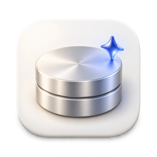

<div align="center">



# Lumen

**あらゆるデバイスのストレージを把握。**

Lumen はディスクを占めているものを見つけ、項目ごとに内容を説明します。
安全に整理できるものだけを、復元可能な隔離領域に移動します。

[](https://github.com/zaewc/Lumen/releases/latest)
[](https://github.com/zaewc/Lumen/actions/workflows/rust.yml)
[](LICENSE)

[**ダウンロード**](https://zaewc.github.io/Lumen/ja/) · [仕組み](ARCHITECTURE.md) · [ロードマップ](docs/architecture/roadmap.md)

<!-- language-tabs:start -->
<p>
<a href="README.ko.md" lang="ko" hreflang="ko"><picture><source media="(prefers-color-scheme: dark)" srcset="docs/assets/readme/language-tabs/ko-dark.svg"></picture></a><a href="README.md" lang="en" hreflang="en"><picture><source media="(prefers-color-scheme: dark)" srcset="docs/assets/readme/language-tabs/en-dark.svg"></picture></a><a href="README.ru.md" lang="ru" hreflang="ru"><picture><source media="(prefers-color-scheme: dark)" srcset="docs/assets/readme/language-tabs/ru-dark.svg"></picture></a><a href="README.ja.md" lang="ja" hreflang="ja"><picture><source media="(prefers-color-scheme: dark)" srcset="docs/assets/readme/language-tabs/ja-selected-dark.svg"></picture></a><a href="README.zh-CN.md" lang="zh-CN" hreflang="zh-CN"><picture><source media="(prefers-color-scheme: dark)" srcset="docs/assets/readme/language-tabs/zh-CN-dark.svg"></picture></a><a href="README.es.md" lang="es" hreflang="es"><picture><source media="(prefers-color-scheme: dark)" srcset="docs/assets/readme/language-tabs/es-dark.svg"></picture></a><a href="README.fr.md" lang="fr" hreflang="fr"><picture><source media="(prefers-color-scheme: dark)" srcset="docs/assets/readme/language-tabs/fr-dark.svg"></picture></a>
</p>
<!-- language-tabs:end -->


<picture>
  <source media="(prefers-color-scheme: dark)" srcset="docs/assets/readme/clean-up-dark.png">
  
</picture>

</div>

## Lumen でできること

- **容量を使っているものを見つけます。** Xcode の DerivedData や Gradle
  キャッシュ、アプリのキャッシュ、古いインストーラーなどを、ファイルを一つも
  開かずにスキャンします。
- **判断の理由を説明します。** 項目を維持・確認・整理候補に分け、その出所、
  再生成できるか、まだ使われているかなどの根拠を示します。
- **勝手に削除しません。** 整理する項目は同じドライブの隔離領域に移動します。
  復元でき、完全に削除するのはあなたが選んだときだけです。
- **ツール自身で整理すべき項目を見分けます。** pnpm ストアや Xcode
  シミュレーターなどはファイルに触れず、そのツール用のコマンドを表示します。
- **AI のセカンドオピニオンを利用できます。** AI レビューは確認が必要な項目を
  説明し、判断をより慎重にすることだけができます。
- **アプリ内で更新できます**（0.5.0 以降）。新しいバージョンは Lumen の署名
  キーで検証してからインストールします。

## 画面の紹介

<table>
  <tr>
    <td width="50%">
      <picture>
        <source media="(prefers-color-scheme: dark)" srcset="docs/assets/readme/review-dark.png">
        
      </picture>
      <p align="center"><b>根拠</b>: 項目の出所と判断理由</p>
    </td>
    <td width="50%">
      <picture>
        <source media="(prefers-color-scheme: dark)" srcset="docs/assets/readme/overview-dark.png">
        
      </picture>
      <p align="center"><b>ストレージ</b>: ディスク容量と最新スキャンの内訳</p>
    </td>
  </tr>
  <tr>
    <td colspan="2">
      <picture>
        <source media="(prefers-color-scheme: dark)" srcset="docs/assets/readme/quarantine-dark.png">
        
      </picture>
      <p align="center"><b>隔離領域</b>: 項目を復元、または複数をまとめて完全に削除</p>
    </td>
  </tr>
</table>

## Lumen の判断方法

すべての判断はモデルではなく、決定論的な安全ポリシーが行います。

| 判断 | 内容 |
| --- | --- |
| **維持** | システムファイル、書類、アプリデータ、使用中やクラウド同期中の項目、Lumen が完全に読み取れなかった項目。 |
| **確認** | Lumen には確信がありません。あなたが判断します。 |
| **整理** | ビルドキャッシュなど、既知で再生成できる項目。まず隔離領域に移動します。 |

迷ったときはファイルを維持するか、確認をお願いします。移動の直前に、項目が
変更されておらず使用中でもないことを再確認します。以前調べたパスではなく、
ファイルハンドルを使って処理します。ルールの詳細は
[スキャナーの安全契約](docs/architecture/scanner.md)と[設計判断記録](docs/decisions/README.md)
を参照してください。

## AI レビュー

**初回起動時に、Lumen は AI レビューを使うか一度だけ確認します。** 選択するまで
何も送信せず、設定からいつでも変更できます
([ADR-0050](docs/decisions/0050-ask-about-ai-review-on-first-launch.md))。有効に
すると、整理候補と確認対象になった大きな項目（最大20件）のメタデータを学校の
AI Hub の Jeb モデルへ送信します。メタデータにはホームフォルダーを `~` に置き
換えたパス、ファイル名、サイズ、経過期間、判断の根拠が含まれます。サービスの
運営者がリクエストを保管する場合があります。**ファイルの内容は送信しません。**
AI の回答は根拠としてのみ扱います。判断をより慎重にすることはできますが、
その逆はできず、移動・削除する項目も選びません
([ADR-0020](docs/decisions/0020-jev-evidence-only-judge.md))。精度と評価方法は
[`docs/ai/`](docs/ai/architecture.md)を参照してください。

## インストール

[ダウンロードページ](https://zaewc.github.io/Lumen/ja/)または
[GitHub Releases](https://github.com/zaewc/Lumen/releases/latest)から最新の
ベータ版をダウンロードできます。

| プラットフォーム | パッケージ | 状態 |
| --- | --- | --- |
| macOS 13 以降（Apple silicon、Intel） | `.dmg` | ベータ |
| Windows 10 22H2 以降、Windows 11 | インストーラー（`-setup.exe`） | ベータ |
| Linux（x86_64） | `.AppImage`、`.deb` | ベータ |
| Android、iOS | | 開発中 |

ベータ版はまだコード署名されていないため、初回起動時に追加の操作が必要です。
macOS では **システム設定 › プライバシーとセキュリティ › このまま開く**、
Windows では **詳細情報 › 実行**を選択してください。各ファイルには SHA-256
チェックサムとビルド来歴の証明が付属します。

```sh
shasum -a 256 -c SHA256SUMS --ignore-missing
gh attestation verify <file> --repo zaewc/Lumen
```

## ソースからビルド

Rust（`rust-toolchain.toml`に記載のバージョン）、Corepack を含む Node.js 24、
[`just`](https://github.com/casey/just)が必要です。

```sh
corepack enable && pnpm install
pnpm --filter @lumen/desktop tauri dev   # デスクトップアプリ
just check                               # フォーマット、lint、テスト、cargo-deny、スキーマ、Web の確認
cargo run -p lumen-cli -- scan ~/Library --db index.db   # 読み取り専用の CLI スキャン
```

プルリクエストを作成する前に[`CONTRIBUTING.md`](CONTRIBUTING.md)と
[`AGENTS.md`](AGENTS.md)を確認してください。

## ドキュメント

| トピック | ドキュメント |
| --- | --- |
| アーキテクチャ | [`ARCHITECTURE.md`](ARCHITECTURE.md)、[システム](docs/architecture/system.md)、[プラットフォーム](docs/architecture/platforms.md) |
| 設計判断 | [`docs/decisions/`](docs/decisions/README.md) |
| ロードマップ | [`docs/architecture/roadmap.md`](docs/architecture/roadmap.md) |
| AI レビュー | [`docs/ai/`](docs/ai/architecture.md) |
| プライバシー | [`docs/operations/privacy.md`](docs/operations/privacy.md) |
| セキュリティ | [`SECURITY.md`](SECURITY.md)、[脅威モデル](docs/security/threat-model.md) |

## 原則

- **空き容量より安全を優先。** 迷ったときはファイルを維持するか、確認をお願いします。
- **推測ではなく根拠を。** すべての提案に説明できる理由があります。
- **AI は助言役。** モデルの出力は根拠であり、決定論的ポリシーが判断します。
- **いつでも元に戻せる設計。** 削除の前に隔離と検証を行い、復元できるようにします。
- **ローカル優先。** スキャン、判断、隔離領域はデバイス内に保管し、ファイルの内容を外部へ送信しません。

## ライセンス

Lumen は[Apache License, Version 2.0](LICENSE)のもとで公開されています。
