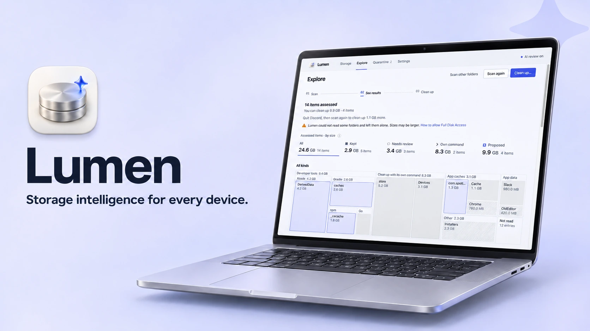
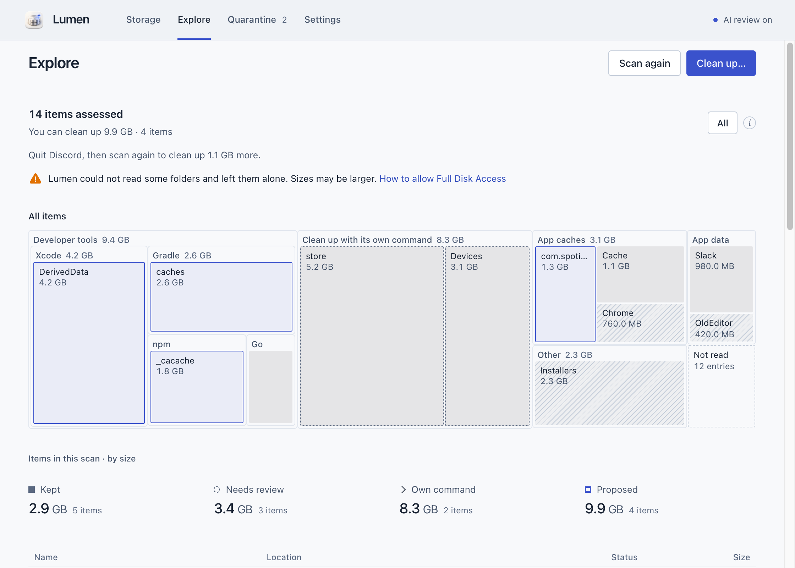
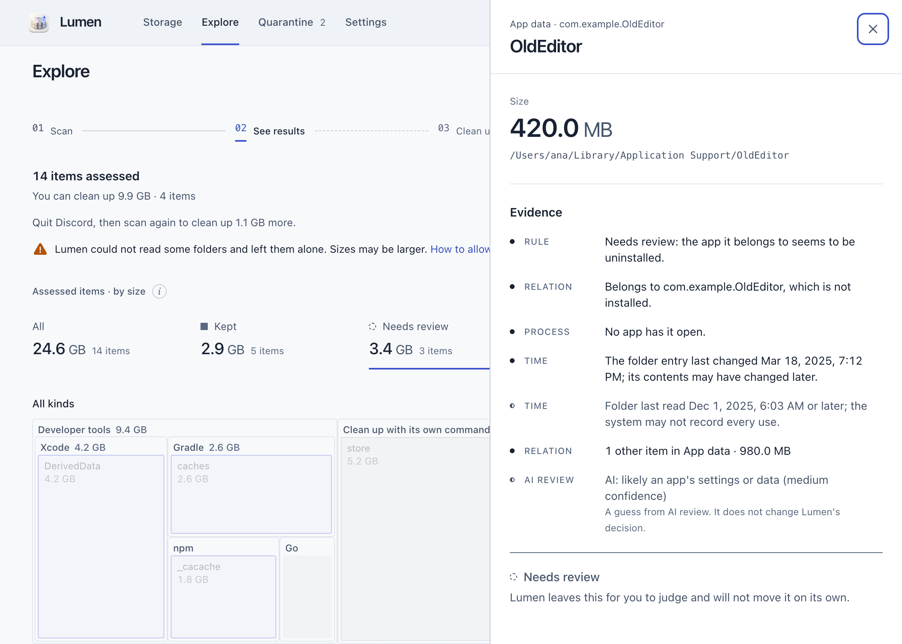
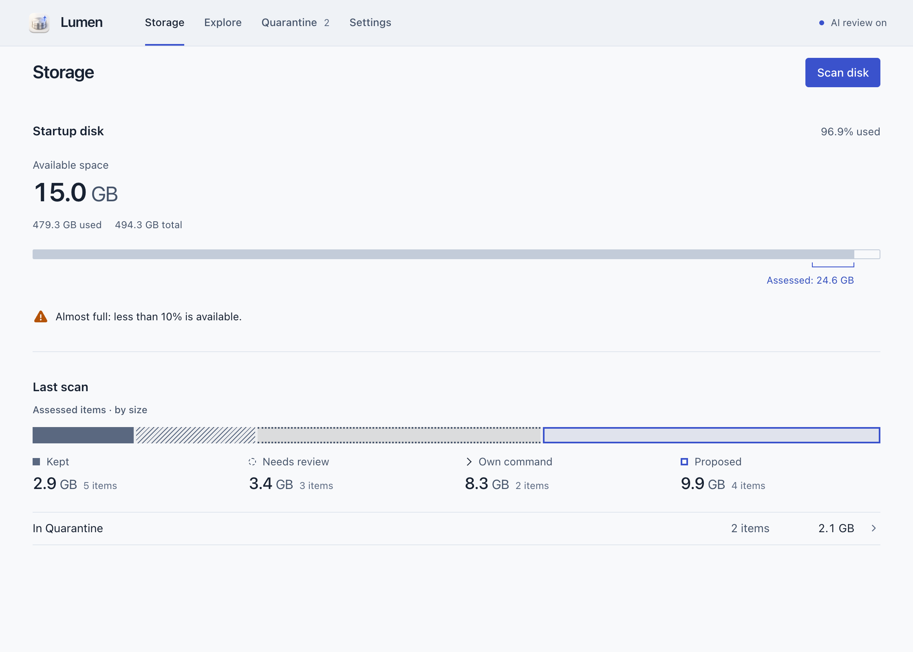
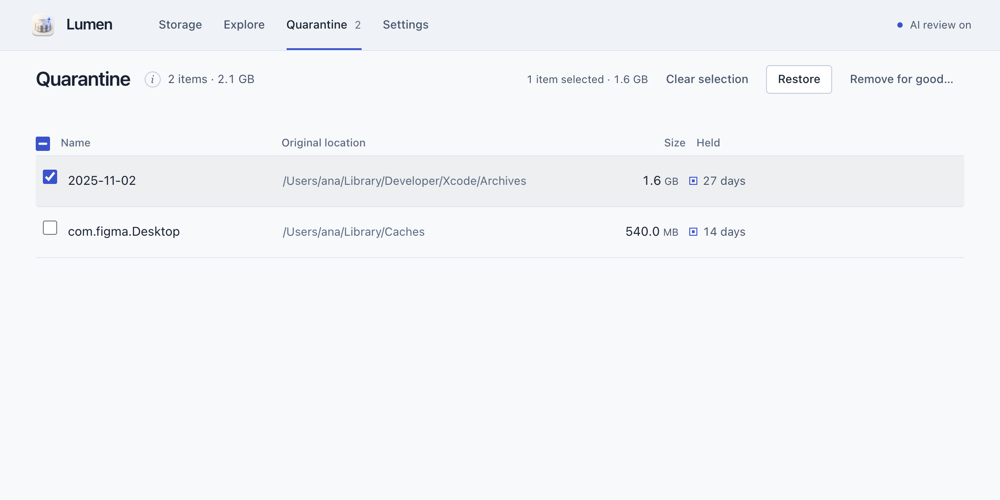

<div align="center">



# Lumen

**모든 기기의 저장 공간을 똑똑하게 관리해요.**

Lumen은 디스크 공간을 차지하는 항목을 찾아 무엇인지 알려줘요. 안전하게 정리할 수
있는 항목만 복원할 수 있는 격리함으로 옮겨요.

[](https://github.com/zaewc/Lumen/releases/latest)
[](https://github.com/zaewc/Lumen/actions/workflows/rust.yml)
[](LICENSE)

[**다운로드**](https://zaewc.github.io/Lumen/) · [작동 방식](ARCHITECTURE.md) · [로드맵](docs/architecture/roadmap.md)

<!-- language-tabs:start -->
<p>
<a href="README.ko.md" lang="ko" hreflang="ko"><picture><source media="(prefers-color-scheme: dark)" srcset="docs/assets/readme/language-tabs/ko-selected-dark.svg"></picture></a><a href="README.md" lang="en" hreflang="en"><picture><source media="(prefers-color-scheme: dark)" srcset="docs/assets/readme/language-tabs/en-dark.svg"></picture></a><a href="README.ru.md" lang="ru" hreflang="ru"><picture><source media="(prefers-color-scheme: dark)" srcset="docs/assets/readme/language-tabs/ru-dark.svg"></picture></a><a href="README.ja.md" lang="ja" hreflang="ja"><picture><source media="(prefers-color-scheme: dark)" srcset="docs/assets/readme/language-tabs/ja-dark.svg"></picture></a><a href="README.zh-CN.md" lang="zh-CN" hreflang="zh-CN"><picture><source media="(prefers-color-scheme: dark)" srcset="docs/assets/readme/language-tabs/zh-CN-dark.svg"></picture></a><a href="README.es.md" lang="es" hreflang="es"><picture><source media="(prefers-color-scheme: dark)" srcset="docs/assets/readme/language-tabs/es-dark.svg"></picture></a><a href="README.fr.md" lang="fr" hreflang="fr"><picture><source media="(prefers-color-scheme: dark)" srcset="docs/assets/readme/language-tabs/fr-dark.svg"></picture></a>
</p>
<!-- language-tabs:end -->


<picture>
  <source media="(prefers-color-scheme: dark)" srcset="docs/assets/readme/clean-up-dark.png">
  
</picture>

</div>

## 어떤 일을 하나요?

- **공간을 차지하는 항목을 찾아요.** 파일을 하나도 열지 않고 Xcode의 DerivedData,
  Gradle 캐시, 앱 캐시, 오래된 설치 파일을 검사해요.
- **모든 결정의 근거를 알려줘요.** 각 항목을 유지하거나 검토 대상으로 남기거나 정리
  대상으로 제안해요. 누가 만들었는지, 다시 만들 수 있는지, 아직 사용 중인지도 함께
  알려줘요.
- **혼자서 삭제하지 않아요.** 정리할 항목은 같은 드라이브의 격리함으로 옮겨요.
  언제든 복원할 수 있고, 영구 삭제는 사용자가 선택할 때만 해요.
- **도구가 직접 정리해야 할 때를 알아요.** pnpm 저장소나 Xcode 시뮬레이터처럼 도구
  자체 명령으로 정리해야 하는 항목은 파일에 손대는 대신 해당 명령을 보여줘요.
- **AI의 의견도 참고할 수 있어요.** AI 검토는 검토가 필요한 항목을 설명해요. 결정은
  더 신중하게만 바꿀 수 있어요.
- **앱 안에서 업데이트할 수 있어요** (0.5.0부터). 새 버전을 Lumen의 서명 키로
  확인한 뒤 앱 안에서 설치해요.

## 화면 미리보기

<table>
  <tr>
    <td width="50%">
      <picture>
        <source media="(prefers-color-scheme: dark)" srcset="docs/assets/readme/review-dark.png">
        
      </picture>
      <p align="center"><b>근거</b>: 항목의 출처와 결정 이유를 확인해요</p>
    </td>
    <td width="50%">
      <picture>
        <source media="(prefers-color-scheme: dark)" srcset="docs/assets/readme/overview-dark.png">
        
      </picture>
      <p align="center"><b>저장 공간</b>: 디스크 용량과 최근 검사 결과를 확인해요</p>
    </td>
  </tr>
  <tr>
    <td colspan="2">
      <picture>
        <source media="(prefers-color-scheme: dark)" srcset="docs/assets/readme/quarantine-dark.png">
        
      </picture>
      <p align="center"><b>격리함</b>: 항목을 복원하거나 여러 항목을 한 번에 영구 삭제해요</p>
    </td>
  </tr>
</table>

## Lumen은 어떻게 결정하나요?

모델이 아니라 정해진 안전 정책이 모든 결정을 내려요.

| 결정 | 의미 |
| --- | --- |
| **유지** | 시스템 파일, 문서, 앱 데이터, 사용 중인 항목, 클라우드에서 동기화한 항목, Lumen이 전부 확인하지 못한 항목은 그대로 둬요. |
| **검토 필요** | 확신할 수 없어요. 직접 확인해 주세요. |
| **정리 제안** | 빌드 캐시처럼 다시 만들 수 있다고 확인된 항목이에요. 먼저 격리함으로 옮겨요. |

확실하지 않으면 항목을 유지하거나 직접 확인할 수 있도록 남겨둬요. 항목을 옮기기
전에 변경되지 않았고 사용 중이 아닌지 다시 확인해요. 이전에 조회한 경로가 아니라
파일 핸들로 작업해요. 자세한 규칙은 [검사 안전 계약](docs/architecture/scanner.md)과
[결정 기록](docs/decisions/README.md)에서 확인할 수 있어요.

## AI 검토

**Lumen은 처음 실행할 때 AI 검토를 사용할지 한 번 물어봐요.** 선택하기 전에는 아무
것도 보내지 않으며, 설정에서 언제든 선택을 바꿀 수 있어요
([ADR-0050](docs/decisions/0050-ask-about-ai-review-on-first-launch.md)). AI 검토를
켜면 Lumen이 정리 대상으로 제안한 항목과 검토 대상으로 남긴 큰 항목 중 최대 20개의
메타데이터를 학교 AI Hub의 Jeb 모델에 보내요. 메타데이터에는 홈 폴더를 `~`로 바꾼
경로, 파일 이름, 크기, 날짜, 결정 근거가 포함돼요. 모델 운영자가 요청을 보관할 수
있어요. **파일 내용은 절대 보내지 않아요.** AI 답변은 근거로만 써요. 결정을 더
신중하게 할 수는 있지만 덜 신중하게 바꿀 수는 없고, 어떤 항목을 옮기거나 삭제할지도
정하지 않아요
([ADR-0020](docs/decisions/0020-jev-evidence-only-judge.md)). AI 검토의 정확도와
측정 방법은 [`docs/ai/`](docs/ai/architecture.md)에서 확인할 수 있어요.

## 설치

[다운로드 페이지](https://zaewc.github.io/Lumen/) 또는
[GitHub 릴리스](https://github.com/zaewc/Lumen/releases/latest)에서 최신 베타를
받을 수 있어요.

| 플랫폼 | 패키지 | 상태 |
| --- | --- | --- |
| macOS 13 이상 (Apple silicon 및 Intel) | `.dmg` | 베타 |
| Windows 10 22H2 이상, Windows 11 | 설치 프로그램 (`-setup.exe`) | 베타 |
| Linux (x86_64) | `.AppImage`, `.deb` | 베타 |
| Android, iOS | | 개발 중 |

베타 버전은 아직 코드 서명을 하지 않았어요. 처음 실행할 때 한 단계를 더 거쳐야
해요. macOS에서는 **시스템 설정 › 개인정보 보호 및 보안 › 그래도 열기**를,
Windows에서는 **추가 정보 › 실행**을 선택해 주세요. 모든 파일에는 SHA-256 체크섬과
빌드 출처 증명이 포함돼요.

```sh
shasum -a 256 -c SHA256SUMS --ignore-missing
gh attestation verify <file> --repo zaewc/Lumen
```

## 소스에서 빌드하기

Rust (`rust-toolchain.toml`에 지정한 버전), Corepack이 포함된 Node.js 24,
[`just`](https://github.com/casey/just)가 필요해요.

```sh
corepack enable && pnpm install
pnpm --filter @lumen/desktop tauri dev   # 데스크톱 앱
just check                               # 포맷, 린트, 테스트, cargo-deny, 스키마, 웹 검사
cargo run -p lumen-cli -- scan ~/Library --db index.db   # 읽기 전용 명령줄 검사
```

풀 리퀘스트를 열기 전에 [`CONTRIBUTING.md`](CONTRIBUTING.md)와
[`AGENTS.md`](AGENTS.md)를 확인해 주세요.

## 문서

| 주제 | 문서 |
| --- | --- |
| 아키텍처 | [`ARCHITECTURE.md`](ARCHITECTURE.md), [시스템](docs/architecture/system.md), [플랫폼](docs/architecture/platforms.md) |
| 결정 기록 | [`docs/decisions/`](docs/decisions/README.md) |
| 로드맵 | [`docs/architecture/roadmap.md`](docs/architecture/roadmap.md) |
| AI 검토 | [`docs/ai/`](docs/ai/architecture.md) |
| 개인정보 보호 | [`docs/operations/privacy.md`](docs/operations/privacy.md) |
| 보안 | [`SECURITY.md`](SECURITY.md), [위협 모델](docs/security/threat-model.md) |

## 원칙

- **저장 공간보다 안전이 먼저예요.** 확실하지 않으면 항목을 유지하거나 직접 확인할 수
  있도록 남겨둬요.
- **추측이 아닌 근거를 제시해요.** 모든 제안에는 설명할 수 있는 이유가 있어요.
- **AI는 참고만 해요.** 모델 답변은 근거일 뿐이고, 정해진 정책이 결정해요.
- **언제든 되돌릴 수 있어요.** 항목은 확인 과정을 거쳐 격리함으로 옮기고 복원할 수
  있어요.
- **기기 안에서 처리해요.** 검사와 결정, 격리함은 기기 안에 보관해요. 파일 내용은
  기기 밖으로 보내지 않아요.

## 라이선스

Lumen은 [Apache License 2.0](LICENSE)에 따라 사용할 수 있어요.
