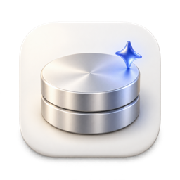
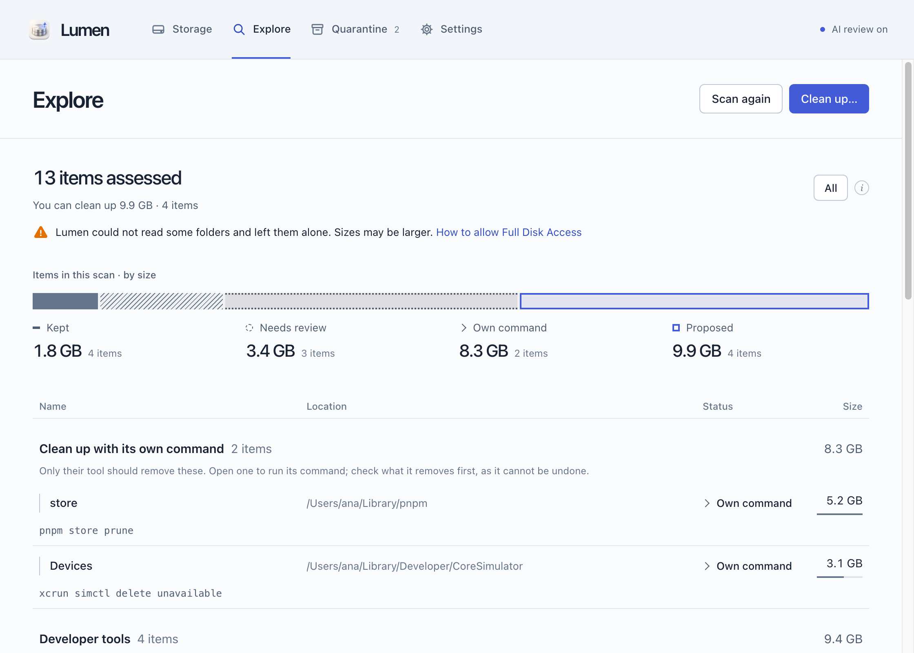
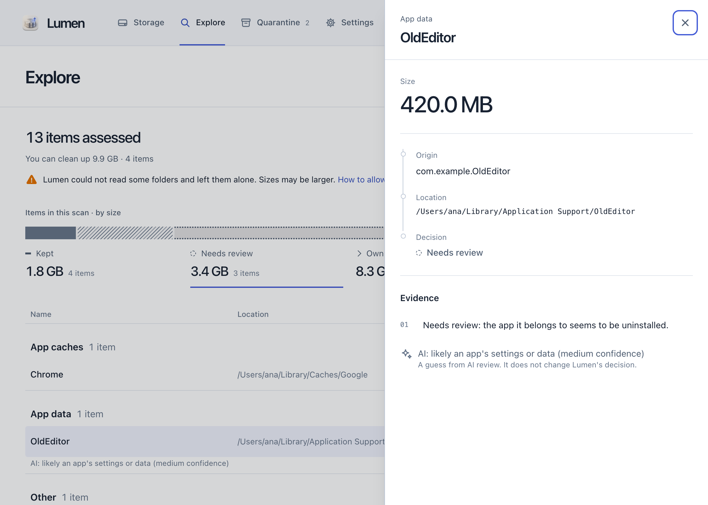
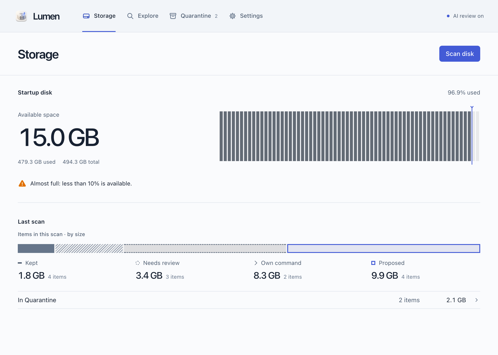
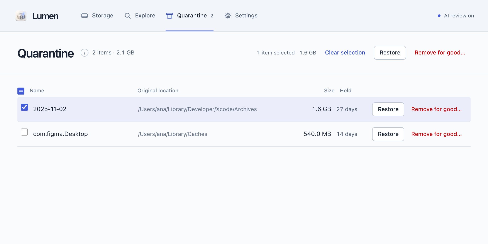

<div align="center">



# Lumen

**Storage intelligence for every device.**

Lumen finds what is filling your disk, explains what each item is, and moves only
what is safe to remove, into a quarantine you can restore from.

[](https://github.com/zaewc/Lumen/releases/latest)
[](https://github.com/zaewc/Lumen/actions/workflows/rust.yml)
[](LICENSE)

[**Download**](https://zaewc.github.io/Lumen/en/) · [한국어](https://zaewc.github.io/Lumen/) · [How it works](ARCHITECTURE.md) · [Roadmap](docs/architecture/roadmap.md)

<picture>
  <source media="(prefers-color-scheme: dark)" srcset="docs/assets/readme/clean-up-dark.png">
  
</picture>

</div>

## What it does

- **Finds what takes space**, from Xcode's DerivedData and Gradle caches to app caches
  and old installers, by scanning without opening a single file.
- **Explains every decision.** Each item is kept, left for you to review, or proposed
  for clean-up, with the evidence behind it: who made it, whether it can be
  regenerated, and whether anything still uses it.
- **Never deletes on its own.** Clean-up moves items into a quarantine on the same
  drive; you can restore them, and they are removed for good only when you say so.
- **Knows when a tool should clean up after itself.** For the pnpm store, Xcode
  simulators and the like, Lumen shows the tool's own command instead of touching
  the files.
- **Has an AI second opinion.** AI review describes items left for review and can
  only make a decision more careful (more below).
- **Updates itself** (from 0.5.0). New versions install from inside the app, verified
  against Lumen's signing key.

## A closer look

<table>
  <tr>
    <td width="50%">
      <picture>
        <source media="(prefers-color-scheme: dark)" srcset="docs/assets/readme/review-dark.png">
        
      </picture>
      <p align="center"><b>Evidence</b>: an item's origin and the reasons behind its decision</p>
    </td>
    <td width="50%">
      <picture>
        <source media="(prefers-color-scheme: dark)" srcset="docs/assets/readme/overview-dark.png">
        
      </picture>
      <p align="center"><b>Storage</b>: disk capacity and the last scan's composition</p>
    </td>
  </tr>
  <tr>
    <td colspan="2">
      <picture>
        <source media="(prefers-color-scheme: dark)" srcset="docs/assets/readme/quarantine-dark.png">
        
      </picture>
      <p align="center"><b>Quarantine</b>: restore anything, or remove several items for good at once</p>
    </td>
  </tr>
</table>

## How Lumen decides

A deterministic safety policy, not a model, makes every decision:

| Verdict | Meaning |
| --- | --- |
| **Keep** | System files, documents, app data, anything in use or synced from the cloud, and anything Lumen could not fully read. |
| **Review** | Lumen is not sure; you decide. |
| **Clean up** | Known, regenerable items, such as build caches. They go to quarantine first. |

When in doubt, Lumen keeps the file or asks. Before moving anything it checks again
that the item is unchanged and not in use, and it acts by file handle, never by a
path it looked up earlier. The rules are in the
[scanner safety contract](docs/architecture/scanner.md) and the
[decision records](docs/decisions/README.md).

## AI review

AI review is **on by default, and you can turn it off** in Settings
([ADR-0047](docs/decisions/0047-ai-review-on-by-default.md)). While it is on, Lumen
sends the metadata of items it proposes and of up to 20 large items left for review
(paths with your home folder as `~`, sizes, ages, the evidence behind the decision)
to the school AI Hub's Jeb model. **File contents are never sent.** The AI's answer
is evidence: it can make a decision more careful, never less, and it never chooses
what to move or delete ([ADR-0020](docs/decisions/0020-jev-evidence-only-judge.md)).
How accurate it is, and how that is measured, is in [`docs/ai/`](docs/ai/architecture.md).

## Install

Download the latest beta from the [download page](https://zaewc.github.io/Lumen/en/)
or [GitHub Releases](https://github.com/zaewc/Lumen/releases/latest).

| Platform | Package | Status |
| --- | --- | --- |
| macOS 13 or later (Apple silicon and Intel) | `.dmg` | Beta |
| Windows 10 22H2 or later, Windows 11 | installer (`-setup.exe`) | Beta |
| Linux (x86_64) | `.AppImage`, `.deb` | Beta |
| Android, iOS | | In development |

The beta is not code-signed yet, so the first launch needs one extra step: on macOS,
**System Settings › Privacy & Security › Open Anyway**; on Windows, **More info ›
Run anyway**. Every file comes with a SHA-256 checksum and a build-provenance
attestation:

```sh
shasum -a 256 -c SHA256SUMS --ignore-missing
gh attestation verify <file> --repo zaewc/Lumen
```

## Build from source

You need Rust (the version in `rust-toolchain.toml`), Node.js 24 with Corepack, and
[`just`](https://github.com/casey/just).

```sh
corepack enable && pnpm install
pnpm --filter @lumen/desktop tauri dev   # the desktop app
just check                               # format, lint, tests, cargo-deny, schemas, web checks
cargo run -p lumen-cli -- scan ~/Library --db index.db   # the command line, read-only scan
```

See [`CONTRIBUTING.md`](CONTRIBUTING.md) and [`AGENTS.md`](AGENTS.md) before opening a
pull request.

## Documentation

| Topic | Where |
| --- | --- |
| Architecture | [`ARCHITECTURE.md`](ARCHITECTURE.md), [system](docs/architecture/system.md), [platforms](docs/architecture/platforms.md) |
| Decisions | [`docs/decisions/`](docs/decisions/README.md) |
| Roadmap | [`docs/architecture/roadmap.md`](docs/architecture/roadmap.md) |
| AI review | [`docs/ai/`](docs/ai/architecture.md) |
| Privacy | [`docs/operations/privacy.md`](docs/operations/privacy.md) |
| Security | [`SECURITY.md`](SECURITY.md), [threat model](docs/security/threat-model.md) |

## Principles

- **Safety over reclaimed space.** When uncertain, Lumen keeps the file or asks.
- **Evidence, not guesses.** Every recommendation is explainable.
- **AI is advisory.** Model output is evidence; a deterministic policy decides.
- **Reversible by default.** Removal goes through quarantine, with verification and
  restore.
- **Local first.** Scans, decisions and quarantine stay on your device; file contents
  never leave it.

## License

Lumen is licensed under the [Apache License, Version 2.0](LICENSE).
