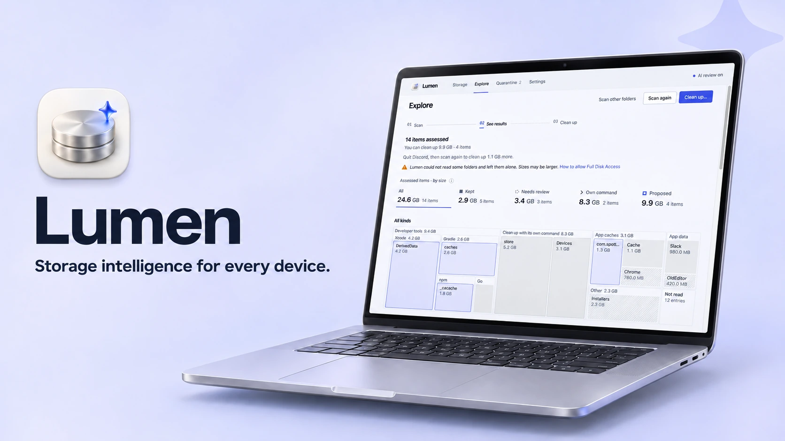

<div align="center">



# Lumen

**Умное управление хранилищем на любом устройстве.**

Lumen находит, что занимает место на диске, и объясняет, что представляет собой
каждый элемент. В карантин, откуда всё можно восстановить, попадает только то, что
безопасно очистить.

[](https://github.com/zaewc/Lumen/releases/latest)
[](https://github.com/zaewc/Lumen/actions/workflows/rust.yml)
[](LICENSE)

[**Скачать**](https://zaewc.github.io/Lumen/ru/) · [Как это работает](ARCHITECTURE.md) · [План разработки](docs/architecture/roadmap.md)

<!-- language-tabs:start -->
<p>
<a href="README.ko.md" lang="ko" hreflang="ko"><picture><source media="(prefers-color-scheme: dark)" srcset="docs/assets/readme/language-tabs/ko-dark.svg"></picture></a><a href="README.md" lang="en" hreflang="en"><picture><source media="(prefers-color-scheme: dark)" srcset="docs/assets/readme/language-tabs/en-dark.svg"></picture></a><a href="README.ru.md" lang="ru" hreflang="ru"><picture><source media="(prefers-color-scheme: dark)" srcset="docs/assets/readme/language-tabs/ru-selected-dark.svg"></picture></a><a href="README.ja.md" lang="ja" hreflang="ja"><picture><source media="(prefers-color-scheme: dark)" srcset="docs/assets/readme/language-tabs/ja-dark.svg"></picture></a><a href="README.zh-CN.md" lang="zh-CN" hreflang="zh-CN"><picture><source media="(prefers-color-scheme: dark)" srcset="docs/assets/readme/language-tabs/zh-CN-dark.svg"></picture></a><a href="README.es.md" lang="es" hreflang="es"><picture><source media="(prefers-color-scheme: dark)" srcset="docs/assets/readme/language-tabs/es-dark.svg"></picture></a><a href="README.fr.md" lang="fr" hreflang="fr"><picture><source media="(prefers-color-scheme: dark)" srcset="docs/assets/readme/language-tabs/fr-dark.svg"></picture></a>
</p>
<!-- language-tabs:end -->


<picture>
  <source media="(prefers-color-scheme: dark)" srcset="docs/assets/readme/clean-up-dark.png">
  
</picture>

</div>

## Что делает Lumen

- **Находит, что занимает место:** от DerivedData Xcode и кэшей Gradle до кэшей
  приложений и старых установщиков — не открывая ни одного файла.
- **Объясняет каждое решение.** Элемент можно оставить, предложить вам проверить или
  предложить очистить. Lumen показывает, кто его создал, можно ли создать его заново
  и используется ли он сейчас.
- **Ничего не удаляет самостоятельно.** При очистке элементы перемещаются в карантин
  на том же диске. Их можно восстановить; окончательное удаление происходит только
  по вашему решению.
- **Понимает, когда очищать должна сама программа.** Для хранилища pnpm, симуляторов
  Xcode и других подобных элементов Lumen показывает команду соответствующего
  инструмента, не трогая файлы напрямую.
- **Предлагает второе мнение ИИ.** Проверка ИИ описывает элементы, требующие внимания,
  и может сделать решение только более осторожным.
- **Обновляется прямо из приложения** (начиная с версии 0.5.0). Перед установкой
  новые версии проверяются ключом подписи Lumen.

## Подробнее о приложении

<table>
  <tr>
    <td width="50%">
      <picture>
        <source media="(prefers-color-scheme: dark)" srcset="docs/assets/readme/review-dark.png">
        
      </picture>
      <p align="center"><b>Доказательства</b>: откуда взялся элемент и почему принято решение</p>
    </td>
    <td width="50%">
      <picture>
        <source media="(prefers-color-scheme: dark)" srcset="docs/assets/readme/overview-dark.png">
        
      </picture>
      <p align="center"><b>Хранилище</b>: емкость диска и результаты последнего сканирования</p>
    </td>
  </tr>
  <tr>
    <td colspan="2">
      <picture>
        <source media="(prefers-color-scheme: dark)" srcset="docs/assets/readme/quarantine-dark.png">
        
      </picture>
      <p align="center"><b>Карантин</b>: восстановление элементов или окончательное удаление нескольких элементов за раз</p>
    </td>
  </tr>
</table>

## Как Lumen принимает решения

Каждое решение принимает детерминированная политика безопасности, а не модель:

| Решение | Значение |
| --- | --- |
| **Оставить** | Системные файлы, документы, данные приложений, используемые или синхронизируемые из облака элементы, а также всё, что Lumen не удалось прочитать полностью. |
| **Проверить** | Lumen не уверен; решение за вами. |
| **Очистить** | Известные элементы, которые можно создать заново, например кэши сборки. Сначала они попадают в карантин. |

Если есть сомнения, Lumen оставляет файл или просит вас проверить его. Перед
перемещением система повторно убеждается, что элемент не изменился и не используется.
Операции выполняются через дескриптор файла, а не по пути, найденному ранее. Правила
описаны в [контракте безопасности сканера](docs/architecture/scanner.md) и
[записях решений](docs/decisions/README.md).

## Проверка с помощью ИИ

**При первом запуске Lumen один раз спрашивает, использовать ли проверку с помощью
ИИ.** До вашего согласия данные не отправляются; настройку можно изменить в любой
момент в параметрах
([ADR-0050](docs/decisions/0050-ask-about-ai-review-on-first-launch.md)). Если
проверка включена, Lumen отправляет модели Jeb школьного AI Hub метаданные элементов,
предложенных к очистке, и до 20 крупных элементов, оставленных для проверки. Это
пути (домашняя папка заменена на `~`), имена файлов, размеры, возраст и основания
решения. Оператор сервиса может хранить запросы. **Содержимое файлов не отправляется.**
Ответ ИИ — это доказательство: он может сделать решение осторожнее, но не наоборот,
и не выбирает, что перемещать или удалять
([ADR-0020](docs/decisions/0020-jev-evidence-only-judge.md)). Точность и способы ее
оценки описаны в [`docs/ai/`](docs/ai/architecture.md).

## Установка

Скачайте последнюю бета-версию на
[странице загрузки](https://zaewc.github.io/Lumen/ru/) или в разделе
[GitHub Releases](https://github.com/zaewc/Lumen/releases/latest).

| Платформа | Пакет | Статус |
| --- | --- | --- |
| macOS 13 или новее (Apple silicon и Intel) | `.dmg` | Бета |
| Windows 10 22H2 или новее, Windows 11 | установщик (`-setup.exe`) | Бета |
| Linux (x86_64) | `.AppImage`, `.deb` | Бета |
| Android, iOS | | В разработке |

Бета-версия пока не подписана сертификатом разработчика, поэтому при первом запуске
нужно выполнить дополнительный шаг: в macOS выбрать **Системные настройки ›
Конфиденциальность и безопасность › Открыть в любом случае**, а в Windows —
**Подробнее › Выполнить в любом случае**. Для каждого файла доступны контрольная
сумма SHA-256 и аттестация происхождения сборки:

```sh
shasum -a 256 -c SHA256SUMS --ignore-missing
gh attestation verify <file> --repo zaewc/Lumen
```

## Сборка из исходного кода

Понадобятся Rust (версия указана в `rust-toolchain.toml`), Node.js 24 с Corepack и
[`just`](https://github.com/casey/just).

```sh
corepack enable && pnpm install
pnpm --filter @lumen/desktop tauri dev   # приложение для компьютера
just check                               # форматирование, линтер, тесты, cargo-deny, схемы и проверки веб-части
cargo run -p lumen-cli -- scan ~/Library --db index.db   # сканирование командной строкой только для чтения
```

Перед созданием pull request ознакомьтесь с [`CONTRIBUTING.md`](CONTRIBUTING.md) и
[`AGENTS.md`](AGENTS.md).

## Документация

| Тема | Документ |
| --- | --- |
| Архитектура | [`ARCHITECTURE.md`](ARCHITECTURE.md), [система](docs/architecture/system.md), [платформы](docs/architecture/platforms.md) |
| Решения | [`docs/decisions/`](docs/decisions/README.md) |
| План разработки | [`docs/architecture/roadmap.md`](docs/architecture/roadmap.md) |
| Проверка ИИ | [`docs/ai/`](docs/ai/architecture.md) |
| Конфиденциальность | [`docs/operations/privacy.md`](docs/operations/privacy.md) |
| Безопасность | [`SECURITY.md`](SECURITY.md), [модель угроз](docs/security/threat-model.md) |

## Принципы

- **Безопасность важнее освобожденного места.** Если есть сомнения, Lumen оставит
  файл или попросит вас проверить его.
- **Факты, а не догадки.** У каждой рекомендации есть объяснение.
- **ИИ только советует.** Ответ модели — доказательство, решение принимает
  детерминированная политика.
- **Возможность отмены по умолчанию.** Перед удалением — карантин и проверка;
  элементы можно восстановить.
- **Сначала локальная обработка.** Сканирование, решения и карантин остаются на
  устройстве; содержимое файлов никуда не передается.

## Лицензия

Lumen распространяется по лицензии [Apache License, версия 2.0](LICENSE).
