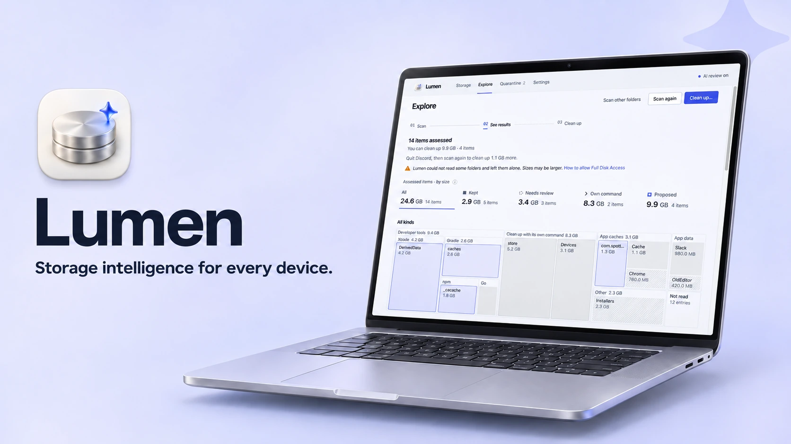

<div align="center">



# Lumen

**适用于各种设备的存储空间管理。**

Lumen 会找出占用磁盘空间的内容，并说明每个项目是什么。只有确认可以安全
清理的项目才会移入可恢复的隔离区。

[](https://github.com/zaewc/Lumen/releases/latest)
[](https://github.com/zaewc/Lumen/actions/workflows/rust.yml)
[](LICENSE)

[**下载**](https://zaewc.github.io/Lumen/zh-CN/) · [工作原理](ARCHITECTURE.md) · [路线图](docs/architecture/roadmap.md)

<!-- language-tabs:start -->
<p>
<a href="README.ko.md" lang="ko" hreflang="ko"><picture><source media="(prefers-color-scheme: dark)" srcset="docs/assets/readme/language-tabs/ko-dark.svg"></picture></a><a href="README.md" lang="en" hreflang="en"><picture><source media="(prefers-color-scheme: dark)" srcset="docs/assets/readme/language-tabs/en-dark.svg"></picture></a><a href="README.ru.md" lang="ru" hreflang="ru"><picture><source media="(prefers-color-scheme: dark)" srcset="docs/assets/readme/language-tabs/ru-dark.svg"></picture></a><a href="README.ja.md" lang="ja" hreflang="ja"><picture><source media="(prefers-color-scheme: dark)" srcset="docs/assets/readme/language-tabs/ja-dark.svg"></picture></a><a href="README.zh-CN.md" lang="zh-CN" hreflang="zh-CN"><picture><source media="(prefers-color-scheme: dark)" srcset="docs/assets/readme/language-tabs/zh-CN-selected-dark.svg"></picture></a><a href="README.es.md" lang="es" hreflang="es"><picture><source media="(prefers-color-scheme: dark)" srcset="docs/assets/readme/language-tabs/es-dark.svg"></picture></a><a href="README.fr.md" lang="fr" hreflang="fr"><picture><source media="(prefers-color-scheme: dark)" srcset="docs/assets/readme/language-tabs/fr-dark.svg"></picture></a>
</p>
<!-- language-tabs:end -->


<picture>
  <source media="(prefers-color-scheme: dark)" srcset="docs/assets/readme/clean-up-dark.png">
  
</picture>

</div>

## Lumen 的功能

- **找出占用空间的内容**，包括 Xcode DerivedData、Gradle 缓存、应用缓存和旧
  安装包；扫描时不会打开任何文件。
- **解释每项决策。** 每个项目会被保留、留给你检查，或建议清理，并附上相关
  证据：项目来源、能否重新生成，以及是否仍在使用。
- **绝不擅自删除。** 清理时，项目会移到同一磁盘上的隔离区；你可以恢复它们，
  只有你确认后才会彻底删除。
- **判断何时应由工具自身清理。** 对于 pnpm 存储、Xcode 模拟器等内容，Lumen
  会显示相应工具的清理命令，而不是直接操作文件。
- **提供 AI 第二意见。** AI 检查会说明需要检查的项目，并且只能让决策变得
  更谨慎。
- **可在应用内更新**（从 0.5.0 版本开始）。安装前会使用 Lumen 的签名密钥
  验证新版本。

## 进一步了解

<table>
  <tr>
    <td width="50%">
      <picture>
        <source media="(prefers-color-scheme: dark)" srcset="docs/assets/readme/review-dark.png">
        
      </picture>
      <p align="center"><b>证据</b>：项目来源及其决策依据</p>
    </td>
    <td width="50%">
      <picture>
        <source media="(prefers-color-scheme: dark)" srcset="docs/assets/readme/overview-dark.png">
        
      </picture>
      <p align="center"><b>存储空间</b>：磁盘容量和最近一次扫描的分类结果</p>
    </td>
  </tr>
  <tr>
    <td colspan="2">
      <picture>
        <source media="(prefers-color-scheme: dark)" srcset="docs/assets/readme/quarantine-dark.png">
        
      </picture>
      <p align="center"><b>隔离区</b>：恢复项目，或一次彻底删除多个项目</p>
    </td>
  </tr>
</table>

## Lumen 如何作出决策

所有决策都由确定性的安全策略作出，而不是由模型决定：

| 决策 | 含义 |
| --- | --- |
| **保留** | 系统文件、文档、应用数据、正在使用或从云端同步的项目，以及 Lumen 无法完整读取的内容。 |
| **检查** | Lumen 无法确定，由你来决定。 |
| **清理** | 已知且可重新生成的项目，例如构建缓存。它们会先移入隔离区。 |

如果无法确定，Lumen 会保留文件或请你检查。移动前会再次确认项目未发生变化且
未在使用，并通过文件句柄操作，而不是使用之前查询到的路径。具体规则见
[扫描安全约定](docs/architecture/scanner.md)和[决策记录](docs/decisions/README.md)。

## AI 检查

**首次启动时，Lumen 会询问一次是否启用 AI 检查。** 在你选择之前不会发送任何
内容；之后也可以随时在设置中更改
([ADR-0050](docs/decisions/0050-ask-about-ai-review-on-first-launch.md))。启用后，
Lumen 会向学校 AI Hub 的 Jeb 模型发送建议清理的项目，以及最多 20 个较大的
待检查项目的元数据。元数据包括路径（主目录以 `~` 表示）、文件名、大小、
时间信息和决策依据。服务运营方可能会保留请求。**绝不会发送文件内容。**
AI 的回答仅作为证据：它可以让决策更谨慎，但不能降低谨慎程度，也不会选择要
移动或删除的项目
([ADR-0020](docs/decisions/0020-jev-evidence-only-judge.md))。准确度及评估方式
见 [`docs/ai/`](docs/ai/architecture.md)。

## 安装

从[下载页面](https://zaewc.github.io/Lumen/zh-CN/)或
[GitHub Releases](https://github.com/zaewc/Lumen/releases/latest)下载最新测试版。

| 平台 | 安装包 | 状态 |
| --- | --- | --- |
| macOS 13 或更高版本（Apple silicon 和 Intel） | `.dmg` | 测试版 |
| Windows 10 22H2 或更高版本、Windows 11 | 安装程序（`-setup.exe`） | 测试版 |
| Linux（x86_64） | `.AppImage`、`.deb` | 测试版 |
| Android、iOS | | 开发中 |

测试版尚未进行代码签名，因此首次启动时需要额外操作：在 macOS 上选择
**系统设置 › 隐私与安全性 › 仍要打开**；在 Windows 上选择
**更多信息 › 仍要运行**。每个文件都附带 SHA-256 校验和及构建来源证明：

```sh
shasum -a 256 -c SHA256SUMS --ignore-missing
gh attestation verify <file> --repo zaewc/Lumen
```

## 从源代码构建

需要 Rust（版本见 `rust-toolchain.toml`）、包含 Corepack 的 Node.js 24，以及
[`just`](https://github.com/casey/just)。

```sh
corepack enable && pnpm install
pnpm --filter @lumen/desktop tauri dev   # 桌面应用
just check                               # 格式、lint、测试、cargo-deny、schema 和 Web 检查
cargo run -p lumen-cli -- scan ~/Library --db index.db   # 只读命令行扫描
```

提交拉取请求前，请阅读 [`CONTRIBUTING.md`](CONTRIBUTING.md) 和
[`AGENTS.md`](AGENTS.md)。

## 文档

| 主题 | 文档 |
| --- | --- |
| 架构 | [`ARCHITECTURE.md`](ARCHITECTURE.md)、[系统](docs/architecture/system.md)、[平台](docs/architecture/platforms.md) |
| 决策 | [`docs/decisions/`](docs/decisions/README.md) |
| 路线图 | [`docs/architecture/roadmap.md`](docs/architecture/roadmap.md) |
| AI 检查 | [`docs/ai/`](docs/ai/architecture.md) |
| 隐私 | [`docs/operations/privacy.md`](docs/operations/privacy.md) |
| 安全 | [`SECURITY.md`](SECURITY.md)、[威胁模型](docs/security/threat-model.md) |

## 原则

- **安全优先于释放空间。** 无法确定时，Lumen 会保留文件或请你检查。
- **以证据为依据，不靠猜测。** 每项建议都有可解释的理由。
- **AI 只提供建议。** 模型输出是证据，最终决策由确定性策略作出。
- **默认可撤销。** 删除前先隔离并验证，且支持恢复。
- **本地优先。** 扫描、决策和隔离区都保留在你的设备上；文件内容不会离开设备。

## 许可证

Lumen 根据 [Apache License, Version 2.0](LICENSE) 授权。
